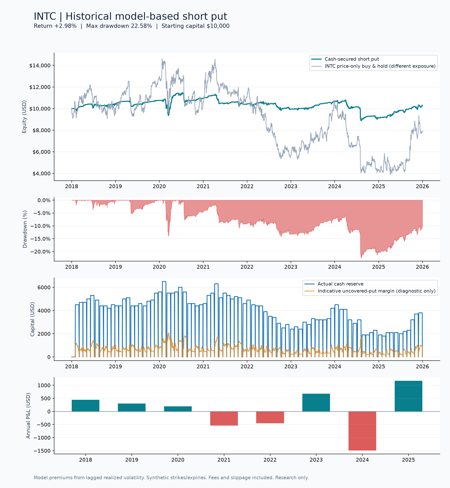
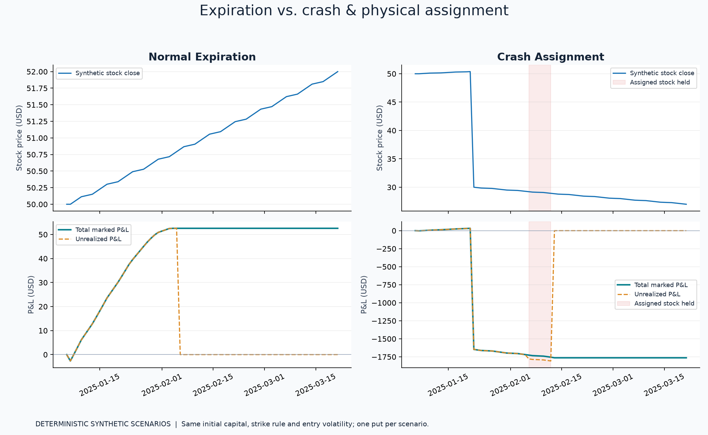

# INTC Short Put Backtest

A reproducible Python research project that sells cash-secured puts on Intel,
marks positions daily, and follows physical assignment into stock ownership.
Built with **pandas, NumPy, and matplotlib**.

[中文说明](README.zh-CN.md)

> **Model-based research, not historical option-chain performance.** Stock prices
> are real INTC daily observations; option premiums and marks come from a
> binomial pricing model using lagged realized volatility. These results do not
> establish an executable trading edge.



### Default snapshot results

| Metric | Model result, 2018–2025 |
|---|---:|
| Final marked equity | $10,298.40 |
| Total net P&L | +$298.40 |
| Cumulative return | +2.98% |
| CAGR | +0.37% |
| Full-period maximum drawdown | 22.58% |
| Put contracts completed | 85 |
| Worthless expirations / assignments | 60 / 25 |
| Maximum cash reserved | $6,500.00 |

The final observation still holds **100 assigned shares** at a $38 strike
cost basis. Their marked value is $3,690.00 and unrealized loss is $110.00;
both are included in final equity. This is not a fully liquidated result.
The modest return and substantial drawdown are reported without parameter
optimization or selective removal of losing years.

## Run locally

Python 3.11 or later. From this repository's root:

```bash
python -m venv .venv
source .venv/bin/activate
# Windows PowerShell: .venv\Scripts\Activate.ps1
python -m pip install -e ".[dev]"
python -m intc_put
python -m pytest -q
```

The default run works **offline after dependency installation**, using the
included INTC snapshot (2018-01-02 through 2025-12-31, 2,011 sessions). It writes
the historical backtest, two separate synthetic scenarios, and comparison
charts into `reports/`. Run from the cloned repository; the snapshot is a
repository artifact rather than package data in a distributable wheel.

To refresh source data explicitly or change parameters:

```bash
python -m intc_put --download --start 2018-01-01 --end 2026-01-01
python -m intc_put --initial-cash 15000 --otm-pct 0.10 --tenor-days 45 --output custom-reports
python -m intc_put --data data/intc_daily.csv --tree-steps 200 --output convergence-reports
```

`--start` and `--end` apply only to downloads; the end is exclusive. A download
failure stops with an explicit error; it does not substitute fabricated prices.
For an exact record of the local validation environment, see
`requirements-lock.txt` (generated under Python 3.14). The installation above
uses compatible dependency ranges on other supported Python versions.
Historical CLI parameter changes apply to the historical backtest. The two
reference scenarios always use documented defaults to preserve a consistent
normal-expiry versus crash-assignment comparison.

## Strategy and accounting

| Setting | Default |
|---|---|
| Starting capital | $10,000 |
| Position | One put contract; 100 shares per contract |
| Strike | 95% of the prior session's close, rounded down to whole dollars |
| Expiry | First supplied session on/after 30 calendar days from entry |
| Pricing | 100-step American CRR binomial tree |
| Volatility | Prior 20 log returns, annualized with 252 sessions, lagged one session |
| Volatility bounds | 10% to 150% annualized |
| Pricing rate / dividend yield | Constant 3% / 0% |
| Option entry cost | $0.65 per contract plus $0.02/share slippage |
| Assignment | If stock closes below strike at expiry, pay strike × 100 and receive 100 shares |
| Assigned stock | Sell after five further supplied sessions; 5 bps stock slippage |
| Position overlap | No new put while a put or assigned stock is held |

Orders use the current day's closing stock price to estimate the option fill,
with the strike and volatility determined by prior data. This is a simplified
market-at-close execution assumption. Contracts, strike increments, and expiry
dates are synthetic; an actual listed contract need not exist at that strike
and date. No new position is opened if its expiry cannot occur within the
sample. Existing assigned stock can remain marked at the final date.

Each close reconciles:

```text
equity = cash + shares × stock_close − short_option_market_value
total_P&L = equity − initial_cash = realized_P&L + unrealized_P&L
cash_secured_reserve = strike × shares_per_contract × number_of_contracts
buying_power = cash − cash_secured_reserve
drawdown = equity / running_peak_equity − 1
```

Premium increases cash at entry, while the short-option liability offsets it;
it is not immediately counted as profit. At physical assignment, the option
expires, strike cash is exchanged for stock, and the stock is marked at the
market price. Its basis is the strike. The premium is recognized once, and
subsequent stock P&L uses that basis, avoiding double-counting the strike-to-spot
loss. Realized P&L here is an accounting convention, not tax reporting.

The strategy fully funds assignment. A second series shows **indicative
uncovered-put maintenance margin** for comparison:

```text
(put_mark + max(0.20 × spot − max(spot − strike, 0), 0.10 × strike)) × shares
```

This follows the basic equity-put maintenance formula described by
[Cboe](https://www.cboe.com/us/options/strategy_based_margin/), but is diagnostic
only: it does not size leveraged positions, model margin calls, or reproduce
any broker's house requirements. Cash collateral is reserved capital, not a
second expense deducted from equity.

## Expiry and crash scenarios



The two explicitly **synthetic** paths use identical opening conditions and one
put each. The first drifts upward so the put expires worthless. The second
gaps down 40%, stays below the strike at expiry, triggers physical assignment,
and demonstrates stock losses during the holding period. A price crash itself
does not automatically cause assignment before expiry in this engine.

The default normal scenario earns **$52.57** after entry costs. The crash
scenario loses **$1,763.16** after assignment and subsequent stock sale.

The pricing tree values American exercise rights, but the event engine models
**expiry-only assignment**. This deliberate mismatch is a limitation: real
American equity puts can be assigned early, as discussed by the
[Options Industry Council](https://www.optionseducation.org/strategies/all-strategies/cash-secured-put).

## Outputs

| File | Contents |
|---|---|
| `reports/historical/performance.png` | Equity, drawdown, capital usage, annual P&L |
| `reports/historical/daily.csv` | Daily cash, liabilities, shares, realized/unrealized P&L, equity, reserves |
| `reports/historical/annual_pnl.csv` | Annual marked P&L, returns and annual drawdown |
| `reports/historical/trades.csv` | Completed option events and assigned-stock exits |
| `reports/historical/events.csv` | Event audit trail |
| `reports/historical/summary.json` | Configuration and full-period metrics |
| `reports/normal_expiration/` | Expiration scenario detail and chart |
| `reports/crash_assignment/` | Assignment scenario detail and chart |
| `reports/run_manifest.json` | Run metrics and input CSV checksum |

Annual P&L is the change from the previous year's final equity (initial capital
for year one), including open-position marks. Annual returns are not summed.
Annual maximum drawdown resets its peak each year; full-period maximum
drawdown retains the full history. CAGR uses elapsed calendar time, including
the initial volatility warm-up. The price-only INTC benchmark excludes
dividends and has a different exposure and capital allocation from the strategy.

## Data and reproducibility

Data comes from the [Yahoo Finance INTC history feed](https://finance.yahoo.com/quote/INTC/history/).
The CSV uses `Close`, not dividend-adjusted `Adj Close`. Yahoo's close is split
adjusted; the feed reports no splits within this sample. Dividend amounts are
retained in the CSV for transparency but are not credited to strategy cash.
The downloader rejects reported splits because contract adjustments are not
implemented. See `data/provenance.json` for request bounds, retrieval time,
provider URL and SHA-256 checksums. The code never forward-fills missing prices.
It rejects invalid supplied rows, but does not verify the exchange calendar
for absent trading dates.

The Yahoo chart endpoint is unofficial and can change or be rate limited.
The stored snapshot makes default results reproducible without network access.
Market data is subject to provider terms; the code license does not license the
underlying market data.

## Limitations and risks

- Realized volatility is not implied volatility. The model omits the observed
  volatility surface, skew, earnings-event premium and the variance risk premium.
- Constant rates, zero dividend yield and no dividend or collateral-interest
  cashflows simplify valuation and can materially bias results.
- Daily closes miss intraday drawdowns, spreads, liquidity, executable option
  quotes, after-hours exercise decisions and assignment-notification delays.
- Fees and slippage are fixed assumptions; actual costs can be much larger.
- Expiry assignment is simplified; early assignment, pin risk, exercise
  thresholds, broker liquidation, taxes and settlement timing are not modeled.
- Selling puts has capped premium upside and potentially severe downside.
  Cash-secured funding prevents borrowing in this simulation; it does not
  prevent large losses if the stock collapses or approaches zero.
- One preselected stock creates concentration and selection bias. Parameters
  are illustrative, not optimized or validated out of sample. Stress paths
  are demonstrations with no associated probability estimate.
- Integer-dollar strikes, artificial expiries and binomial discretization
  introduce modeling error. No performance or risk claim should be described
  as a realized trading record.

## Project layout

```text
intc_put/
  data.py        # source validation, download and provenance
  model.py       # American put valuation
  engine.py      # event-driven cash, position and P&L accounting
  scenarios.py   # deterministic normal and crash paths
  reports.py     # statistics, CSV/JSON exports and matplotlib figures
  __main__.py    # runnable command line
tests/           # financial invariants, edge cases and regression tests
data/            # cached real INTC daily prices and provenance
reports/         # reproducible outputs
docs/            # validation record and resume bullets
```

Tests cover hand-calculated expiry and assignment cashflows, option valuation
bounds, capital constraints, lagged inputs, invalid data and annual-accounting
reconciliation. The GitHub Actions workflow tests supported Python versions and
reproduces charts from the offline snapshot. See `docs/VALIDATION.md` for the
checks actually executed locally; a workflow definition alone is not a passed
remote CI run.

See [resume bullets](docs/RESUME_BULLETS.md) for a factual project description.

## License

MIT for the source code. Market data retains its provider's terms and ownership.
